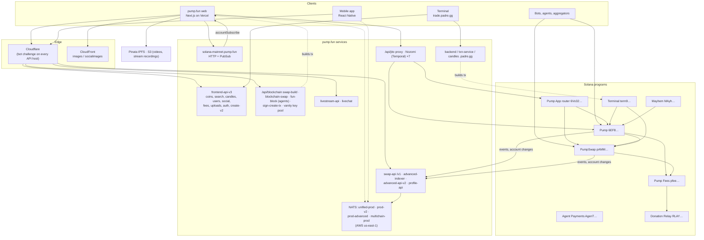

# pump.fun: the whole system

How pump.fun is built, on chain and off chain, as of **28 October 2026**. An earlier on-chain map from 2026-10-26 was
re-verified against mainnet. The backend was mapped from the web app's own
traffic, its bundled API contract and its runtime config, read signed out in a browser. Every fact carries a source
tag, defined in [sources.md](sources.md).

## System map



Read it as follows. Clients reach pump.fun's services through Cloudflare. Transactions are built in the browser
(create + first buy) or by pump.fun's builders (swap-build, the agents API, Terminal's txn-service), and the user's
wallet signs them. The web app sends them itself, to Nozomi or to Jito through a proxy, with a tip and a priority fee
it estimates on pump.fun's own RPC. App trades enter through the Pump App router, which charges the 0.45% app fee and
calls Pump or PumpSwap. Indexers turn the programs' events into the API's coins, candles, boards and PnL, and push
changes over NATS and board sockets. Open pages also watch the curve or pool account directly over RPC PubSub.

## On chain

| Program | Address | Role | Upgrade authority | Last deploy (UTC) |
| --- | --- | --- | --- | --- |
| [Pump](onchain/pump.md) | `6EF8rrecthR5Dkzon8Nwu78hRvfCKubJ14M5uBEwF6P` | Coin creation, bonding curve, graduation | 3-of-4 Squads vault `7gZufwwA…` | 2026-10-19 17:47 |
| [PumpSwap](onchain/pump-amm.md) | `pAMMBay6oceH9fJKBRHGP5D4bD4sWpmSwMn52FMfXEA` | AMM; canonical pool per graduated coin; boost | same | 2026-10-19 17:47 |
| [Pump Fees](onchain/pump-fees.md) | `pfeeUxB6jkeY1Hxd7CsFCAjcbHA9rWtchMGdZ6VojVZ` | Fee schedules, sharing configs, buyback vaults, social and donation fees, referral vaults | same | 2026-10-12 17:40 |
| [Mayhem](onchain/mayhem.md) | `MAyhSmzXzV1pTf7LsNkrNwkWKTo4ougAJ1PPg47MD4e` | The mayhem agent's trading program; 63,644 SOL vault | same | 2026-10-02 15:47 |
| [Agent Payments](onchain/pump-agent-payments.md) | `AgenTMiC2hvxGebTsgmsD4HHBa8WEcqGFf87iwRRxLo7` | Tokenized-agent invoices, buy-and-burn | same | 2026-06-30 15:58 |
| [Pump App router](onchain/pump-app-router.md) | `6Vo3245eszAb5wuqEMw8mGdbfRUdKbHhDHP5LcaGuTAB` | App trades (`bonding_curve_v3`, `pump_swap_v3`, Raydium, Meteora); 0.45% fee | single keypair `92gWFZMp…` | 2026-10-09 11:01 |
| [Terminal](onchain/terminal.md) | `term9YPb9mzAsABaqN71A4xdbxHmpBNZavpBiQKZzN3` | Terminal's `validate_nonce` + `route` | off-curve `5oJNGGDx…` | 2026-10-19 08:57 |
| [Donation Relay](onchain/donation-relay.md) | `RLAYHr9TRFcKB2ubYQhspcnXiaGpaVzNQvHytt47RZu` | Donation PDAs → swap → recipients | off-curve `9rmqZkmn…` | 2026-04-24 20:54 |
| [transfer-hook-authority](onchain/transfer-hook-authority.md) | `333UA891CYPpAJAthphPT3hg1EkUBLhNFoP9HoWW3nug` | Empty, immutable Anchor program | none (immutable) | 2025-07-14 17:43 |

All read on 2026-10-28 at slot 462,377,442 [chain]. Cross-cutting pages:
[cpi-graph.md](onchain/cpi-graph.md) (who calls whom), [token-and-modes.md](onchain/token-and-modes.md) (Token-2022 mint,
metadata, mode flags), [authorities.md](onchain/authorities.md) (every key), [fees.md](onchain/fees.md) (where each
lamport goes), [lifecycle.md](onchain/lifecycle.md) (create → curve → pool). Instruction tables per program are
generated from [idl/](idl/).

## Off chain

| Service | Host(s) | Page |
| --- | --- | --- |
| Main API (330-route contract) | `frontend-api-v3.pump.fun` | [backend/frontend-api-v3.md](backend/frontend-api-v3.md) · [contract](data/frontend-api-v3-contract.md) |
| Data services | `swap-api.pump.fun/v1`, `advanced-indexer.pump.fun`, `advanced-api-v2.pump.fun`, `profile-api.pump.fun` | [backend/data-services.md](backend/data-services.md) |
| Transaction building, priority fees, Jito and Nozomi, RPC | `pump.fun/api/blockchain`, `blockchain-swap.pump.fun`, `fun-block.pump.fun`, `pump.fun/api/jito`, `*.secure.nozomi.temporal.xyz`, `solana-mainnet.pump.fun` | [backend/transactions.md](backend/transactions.md) |
| Realtime | `*.nats.realtime.pump.fun` (×4), RPC PubSub, `advanced-indexer /ws/trenches`, `livechat.pump.fun` | [backend/realtime.md](backend/realtime.md) |
| Livestreams | `livestream-api.pump.fun`, `livechat.pump.fun` | [backend/livestream.md](backend/livestream.md) |
| Media and metadata | Pinata (`pump.mypinata.cloud`), `images.pump.fun`, `socialimages.pump.fun`, S3 | [backend/media-and-metadata.md](backend/media-and-metadata.md) |
| Web app, hosting, edge, vendors | `pump.fun` (Vercel behind Cloudflare), `/api/*` routes, LaunchDarkly, Datadog, Privy, … | [backend/web-and-edge.md](backend/web-and-edge.md) |
| Mobile app and Terminal | React Native app; `trade.padre.gg` + `*.padre.gg` | [backend/mobile-and-terminal.md](backend/mobile-and-terminal.md) |
| Not pump.fun's | PumpPortal, Bitquery, Solana Tracker, Jupiter, launchers | [backend/third-party.md](backend/third-party.md) |

## Flows

| Flow | Page |
| --- | --- |
| Create a coin (free server-side creation; create + first buy with a vanity mint; agents API) | [flows/create-coin.md](flows/create-coin.md) |
| Buy (curve or pool, through the App router) | [flows/buy.md](flows/buy.md) |
| Sell | [flows/sell.md](flows/sell.md) |
| Graduate to PumpSwap (synthetic migration, `migrate_v2`, boost) | [flows/graduate.md](flows/graduate.md) |
| Claim creator fees (sweep, collect, distribute) | [flows/claim-creator-fees.md](flows/claim-creator-fees.md) |
| A livestream | [flows/livestream.md](flows/livestream.md) |

## Features

How every feature beyond create, buy and sell is implemented: callouts and feeds, follows and DMs, squads and
competitions, leaderboards and achievements, creator fees, holder rewards, cashback, referrals and payouts, HyperCore
perps, the 19-chain registry and bridge, limit orders on durable nonces, custom pairs, card packs, Mayhem, tokenized
agents, Go.fun bounties, Privy sign-in and the keyed developer API. Index and rollout timeline:
[features/README.md](features/README.md).

## How the backend is built

A reconstruction from the evidence: a NestJS BFF (`client-server`) over gRPC domain services (`coin-communities`,
`TradeApi`, the coin registry, `profile-service`, `livestream-service`, …), a protobuf trading stream, four NATS
clusters, server-built transactions (`blockchain-api-service`), and keepers with hot keys; then a blueprint to build
the same system (repository, contracts, schemas, subjects, jobs, deployment, build order):
[reconstruction/README.md](reconstruction/README.md).

## Backend skeleton

[skeleton/](skeleton/README.md) builds the blueprint as a local, runnable backend: a zod HTTP contract package (85
routes, 63 working), runtime-loaded protobuf (`trading.v1`, `communities.v1`, `coins.v1`), Postgres migrations and
ClickHouse DDL, a Rust ingest with six Anchor event decoders, TradeApi and the protobuf WSS gateway, the NestJS BFF
with the keyed host, communities, coins, tx-builder, limit orders on durable nonces, the holder-rewards keeper,
profile, notify, live and bounties, bridge, per-user NATS auth, and unapplied container and Kubernetes config. Its
local stores run as `pumpskel-*` containers from `skeleton/infra/compose.yaml` (Postgres 5641, ClickHouse
8641/9641, Redis 6641, NATS 4641/8642); services use ports 4345–4358.

## Since 2026-10-26

- **Programs:** no upgrade, no authority change, no new multisig transaction (index still 157). `Global`,
  `GlobalConfig`, both `FeeConfig`s and `FeeProgramGlobal` read the same. `QuoteControl` repriced 202 starting
  reserves. The Mayhem vault fell from 64,224.34 to 63,644.26 SOL [chain].
- **IDLs:** newest published is `pump-rust-client` 0.5.0 (2026-10-19). Its only change since docs `639b87f` is support
  for Token-2022 quote mints with a transfer fee (`quote_transfer_fee` in trade events, error `QuoteMintNotWritable`)
  [idl].
- **New on chain:** the router's live instructions are `bonding_curve_v3` / `pump_swap_v3`, and Terminal's is
  `route`, both recovered from discriminators. Instruction names for Mayhem, the router and Terminal come from their
  binaries. The Mayhem agent signs as `Gygj9QQb…`. `transfer_hook_authority` is immutable. An earlier Agent Payments
  address in the web bundle is a closed program [chain] [tx] [sdk-bin].
- **Off chain (new in this folder):** the full service map above. pump.fun is multichain in its API and feed
  (Solana, Ethereum, Base and Robinhood Chain through the Pons launchpad), runs callouts, DMs, squads,
  competitions, card packs, HyperCore perps and a developer API-key platform, and creates coins server-side for free
  creation [capture] [contract].
- **Second pass (same day):** 330 contract routes (68 public on `api.pump.fun`), the error registry, every
  `/api/blockchain` builder, limit orders on durable nonces, the protobuf uapi stream, a 19-chain registry, a 95-flag
  rollout registry, pump.fun's docs pages and internal service names [contract] [bundle] [site-docs].

## Files

| Path | Contents |
| --- | --- |
| `onchain/` | One page per program, plus CPI graph, token and modes, authorities, fees, lifecycle |
| `backend/` | One page per service group |
| `flows/` | Six end-to-end sequences |
| `features/` | One page per feature area, with the rollout timeline from the flag registry |
| `reconstruction/` | Services, data pipeline, keepers and signers, and a build blueprint |
| `skeleton/` | The blueprint built as a local backend (TypeScript workspaces, Rust ingest, migrations, infra) |
| `idl/` | IDLs from `pump-rust-client` 0.5.0; `onchain/` (Anchor IDL accounts); `previous-docs-repo-639b87f/` |
| `data/` | `capture-log.md`, `frontend-api-v3-contract.md`, `live-snapshot.json`, `flows-snapshot.json` (multisig section refreshed), `extra-snapshot.json`; `previous/` holds the 2026-10-26 snapshots |
| `scripts/` | Read-only, no dependencies: `read-live.mjs`, `read-flows.mjs`, `read-extra.mjs`, `idl-tables.mjs`, `idl-diff.mjs`, `so-strings.mjs`, shared `lib.mjs` |

## Reproduce

```bash
node scripts/read-live.mjs
```

```bash
node scripts/read-flows.mjs keys
```

```bash
node scripts/read-extra.mjs <folder holding pump-rust-client 0.5.0's artifacts/*.so>
```

`RPC_URL` overrides the public endpoint. The scripts only read, space their calls and retry on HTTP 429.
