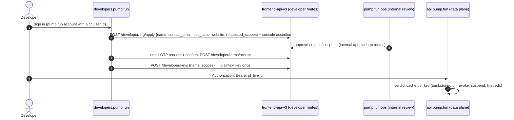

# Developer API and partner access

pump.fun runs a keyed public API at **`api.pump.fun`** with a self-serve console at **`developers.pump.fun`**. The
same route contract serves both hosts: a route is public when the contract wraps it in `publicRead(scope, …)` [contract]
[bundle] [dns].

## Credentials and hosts

| Point | How it works | Source |
| --- | --- | --- |
| Key format | `pf_live_…` with a fixed prefix, length, charset and a checksum; sent as `Authorization: Bearer <key>` or `x-api-key: <key>` | [contract] error registry |
| Host separation | The keyed host accepts only keys; the first-party host (`frontend-api-v3`) accepts only sessions (cookie or user JWT). Crossing them answers `API_CREDENTIAL_NOT_ALLOWED` | [contract] |
| No session on keys | Routes that serve "the signed-in user" need `user=<wallet or username>` with a key (`API_USER_REQUIRED`); viewer-relative fields (own rank, follow state) are absent on the API host | [contract] |
| Region | Same regional availability as pump.fun (`API_REGION_RESTRICTED`) | [contract] |
| Limits | A per-key burst bucket, a UTC daily limit (0 pauses the key), a per-IP failed-auth throttle and a per-IP lookup budget; `429` with `retryAfterMs` | [contract] |

## Scopes and the public surface

Six scopes: `profiles.read`, `graph.read`, `content.read`, `leaderboards.read`, `positions.read`, `moderation.read`.
New keys get every scope but `moderation.read`, which ops grant. 68 routes are public [contract]:

| Scope | Routes | Examples |
| --- | --- | --- |
| `content.read` | 18 | callouts by user, coin, id; replies, quotes, reposts; posts; home feed; New feed; video feed |
| `graph.read` | 17 | follows v3 (pages, search, counts), likers and reposters, group members and member PnL, follow suggestions |
| `profiles.read` | 13 | users by id or wallet, batch, search, overview, verified, achievements, callout stats, `search/resolve` |
| `leaderboards.read` | 12 | PnL boards (wallet, group, positions, top-trader trades), competitions and entries, payouts board, Mayhem top traders |
| `positions.read` | 7 | `mint-positions`, `user-portfolio`, `user-positions`, `user-trades`, `portfolio-summary` (+ chart, balances) |
| `moderation.read` | 1 | `GET /moderation/ban/address/{address}` |

Every public route also declares the keyed error codes (`API_KEY_INVALID`, `API_KEY_REVOKED`, `API_KEY_RATE_LIMITED`,
`API_ORG_NOT_APPROVED`, `API_ORG_SUSPENDED`, `API_REGION_RESTRICTED`, `API_SCOPE_FORBIDDEN`, …) [contract].

## Orgs and keys

| Point | How it works | Source |
| --- | --- | --- |
| Org | One org per owner; applications only through the console (an `x-pump-console-assertion` header); status applied → approved / closed / suspended | [contract] |
| Email | A 6-digit code: 60 s resend lock, 600 s validity, 5 attempts, a daily send cap per org | [contract] |
| Terms | Versioned API terms; acceptance records version, acceptor, time and IP | [contract] |
| Keys | Listed as prefix + last 4, scopes, limits, status, last use; a capped number of active keys per org | [contract] |
| Rotation | `POST /developer/keys/{id}/rotate {grace_hours}` issues a sibling key (same name, scopes, limits); the old key is `rotating` and still served until `grace_until` (1 h to 7 d) | [contract] |
| Revocation | Idempotent; the data plane refuses the key on the next request because the key's cached "verdict" is tombstoned in the same request. Ops can suspend an org (every key tombstoned), revoke all keys, or set a key's limit to 0 as a kill switch | [contract] |
| Usage | `GET /developer/keys/{id}/usage?range=24h|30d` from Redis counters (per minute or per hour); ops see 90 days from BigQuery and an audit log | [contract] |
| Deprecations | Every deprecated public route states `since` and `sunset`, with at least 90 days between them | [contract] |
| Error body | `{statusCode, timestamp, path, error, message}`; `error` is a Nest reason phrase or a registry code (`^[A-Z][A-Z0-9_]+$`); registry entries carry `status`, `owner` (auth, groups, callout, competitions, api-platform, x-link, …), `actionable` and `retryable` (`never` / `after` / …) | [contract] |

## Other programmatic doors

- **Agents API** (`fun-block.pump.fun/agents/*`): server-built create, swap, collect-fees and sharing-config
  transactions for bots ([../flows/create-coin.md](../flows/create-coin.md)) [docs pump-fun-skills].
- **Mayhem partner API**: partners trigger Mayhem trades for wallets in their custody
  ([packs-mayhem-agents-bounties.md](packs-mayhem-agents-bounties.md)) [contract].
- **Public SDKs and IDLs**: `@pump-fun/pump-sdk`, `pump-swap-sdk`, `agent-payments-sdk`, `pump-rust-client` [sdk].
