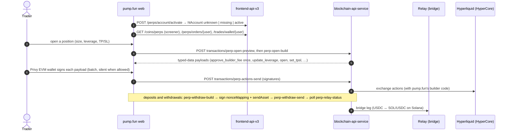

# Perps on HyperCore, and the multichain layer

## Perps (Hyperliquid HyperCore)

pump.fun trades Hyperliquid perpetuals for its users without the browser ever calling Hyperliquid. Every read and
every action goes through pump.fun's servers, and the user's EVM wallet (a Privy embedded wallet linked to the
account) only signs EIP-712 payloads that the server built [bundle] [contract].

| Point | How it works | Source |
| --- | --- | --- |
| Account | `POST /perps/account/activate` asks `cc` to probe the user's canonical EVM wallet on Hyperliquid; answers `unknown` (probe pending), `missing` or `active` | [contract] |
| Signing allowlist | The client maps each server action to an EIP-712 primary type and refuses anything else: `approve_builder_fee` → `HyperliquidTransaction:ApproveBuilderFee`; `set_referrer`, `update_leverage`, `add_margin`, `open`, `open_fallback`, `close`, `cancel`, `set_tpsl` → `Agent` (Exchange domain); `hl_send_asset` → `HyperliquidTransaction:SendAsset`; `set_abstraction` → `UserSetAbstraction` (`unifiedAccount`); `relay_nonce_mapping` → Relay's `NonceMapping` | [bundle] |
| Builders | `/api/blockchain/transactions/perp-fees`, `perp-open-preview`, `perp-open-build`, `perp-actions-build`, `perp-actions-send`, `perp-withdraw-build`, `perp-withdraw-send`, `perp-relay-status` (45 s timeout) | [bundle] |
| Withdraw | Build returns a `template`, a `sendAsset` payload and optionally a Relay `nonceMapping`; the client signs both (concurrently when the wallet signs silently), sends `{template, send_asset_signature, nonce_mapping_signature}`, retries a `bridge` send at 1 s and 2 s, then long-polls Relay status until `success`. The payout asset can switch between what was asked and what was delivered (`denomination_out`) | [bundle] |
| Rails | `bridge` (Relay) with a fallback rail chosen by the server (`railFallbackReason`) | [bundle] |
| Market data | `GET /coins/perps` (sort by 24 h volume, open interest, funding, 24 h change; rows are coin records with `assetClass` perpetual); HIP-3 dexes appear as dex-prefixed coin names (`xyz:TSLA`) | [contract] |
| Orders and fills | `GET /perps/orders/{userId}` (resting TP, SL and limit orders, from TradeApi `GetOpenOrders`); `GET /trades/wallet/{userId}?kinds=perp_fill,perp_transfer,perp_funding` | [contract] |
| Social | Perp callouts (`chain=hlcore:mainnet`), perp alerts, perp replay videos with leverage and liquidation price | [contract] |
| Fees | A builder fee of up to 0.10% of notional per order (approved by signature on first use), up to 0.25% per bridge transfer; the 0.45% platform fee does not apply to perps | [site-docs fees] |
| Rollout | `webPerps` 2026-10-07, then presigned open and close, optimistic positions, margin top-up, close-on-fill, payout fast-sign, bridge rail, venue switch (2026-10-17 → 10-27) | [bundle flag registry] |

## Chains

The web app carries a chain registry of 19 entries, each with a CAIP-2 id, a Relay slug and a DexScreener slug
[bundle]:

| CAIP-2 | Chain | Relay | Notes |
| --- | --- | --- | --- |
| `solana:5eykt4UsFv8P8NJdTREpY1vzqKqZKvdp` | Solana | `solana` | Codex network id `1399811149` in records |
| `eip155:1`, `8453`, `56`, `137`, `42161` | Ethereum, Base, BNB Chain, Polygon, Arbitrum | yes | |
| `eip155:4663` | Robinhood Chain | `robinhood` | Pons launchpad (`ponsv2`), tokenized stocks, `/api/relay/rpc/*` proxy |
| `eip155:143`, `999`, `57073`, `5042`, `4326`, `196` | Monad, HyperEVM, Ink, Arc, MegaETH, X Layer | Relay for all but MegaETH | Ink and Arc RPC through `ink-mainnet.pump.fun` / `arc-mainnet.pump.fun` (`rpc-proxy-worker`, Alchemy upstream) |
| `hlcore:mainnet`, `hlcore:testnet` | HyperCore | — | perps |
| `ton:-239`, `ton:-3` | TON | — | callouts and positions |
| `near:mainnet` | NEAR | — | callouts, positions, PnL; wallet screening for NEAR accounts |
| `starknet:SN_MAIN` | Starknet | — | callouts, boards, PnL |

The registry notes say a new EVM chain needs three admissions: a Relay route, `coin-details-api`, and
`blockchain-api-service` [bundle].

## Cross-chain buys and the bridge

- **Relay buy**: `POST /api/blockchain/transactions/relay-buy-preview` and `relay-buy-build` return a server-built
  deposit transaction with `request_id`, `to_amount`, `to_amount_min`, fees, USD amounts and price impact; the client
  decodes, signs and sends it, then polls status [bundle].
- **Bridge API**: `https://intents.pump.fun` (`NEXT_PUBLIC_BRIDGE_API_URL`, header `x-pump-platform: web`) serves
  quote, execute and status (polled every 2 s for up to 60 s) for EVM ↔ Solana moves [bundle] [capture].
- **Fees**: 0.10%–0.15% of each EVM transaction, on top of the platform fee and the bridge's own fee; the platform
  pays EVM gas [site-docs fees]. The flags `webEvmWithdrawGasTopup`, `webDepositEvmNetworks` and `webNativeConvert`
  (2026-10-21) cover gas top-ups, deposits from EVM networks and native-asset conversion [bundle flag registry].
- **EVM limit orders**: `/api/blockchain-limit/transactions/evm/<route>` with a factory contract; see
  [trading-tools.md](trading-tools.md) [bundle].

## Linking an EVM wallet

`POST /wallet-mapping/challenge` issues a single-use v2 message; `POST /wallet-mapping/link {evmAddress, signature,
messageVersion, nonce, expiresAt, allowRebind}` links it with an EIP-191 signature naming the session's Solana
wallet. One canonical EVM wallet per account; moving one needs `allowRebind` [contract]. Users records then carry
`canonical_svm_wallet` and `canonical_evm_wallet` [capture], and the per-user NATS token covers both wallets'
`positions.*` and `account_balance_change.*` subjects [contract].

## Robinhood Chain stocks

Coins on Robinhood Chain come from the Pons launchpad. `POST pump.fun/api/relay/rpc/tokens/batch` returns per token
the pool, launchpad program, creator, migration state, `isHolderReward`, `assetClass`, `canonicalStock`,
`underlyingSymbol`, and the operator's bypass and blacklist; `GET /api/relay/rpc/stocks` lists stocks [capture]. A
flag routes stock bridging by region (`bridgeStockRegionRouting`) [bundle flag registry].
