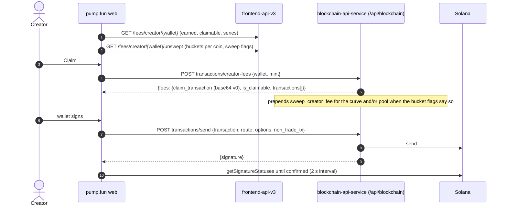

# Rewards, fees back to users, referrals, the PUMP buyback

Each reward stream pairs an on-chain account with an off-chain ledger, and most are paid out by a pump.fun keeper.
On-chain details are in [../onchain/pump.md](../onchain/pump.md), [../onchain/pump-fees.md](../onchain/pump-fees.md)
and [../onchain/fees.md](../onchain/fees.md).

| Stream | On chain | Off chain | Who moves the money |
| --- | --- | --- | --- |
| Creator fees | Pump creator vault and PumpSwap coin-creator vault per creator; `sweep_creator_fee` moves a coin's accrued fee into it | `GET /fees/creator/{address}` (earned per quote, claimable, series), `/unswept` (open buckets per coin) | The creator, with a server-built transaction |
| Fee sharing | `SharingConfig` (Pump Fees): shareholders in bps, an admin that can be transferred or revoked | `GET /fees/coin/{chainId}/{address}` (config and its event history), `GET /fees/shareholder/{id}` | The config admin or any caller of `distribute_creator_fees`, then each shareholder |
| Holder rewards | `["holder-rewards", mint]` PDA under Pump receives the creator fee; `distribute_fee_to_holders(amounts)` | `GET /fees/holder-rewards` (the "book"), page `/holder-rewards` | pump.fun's `holder_reward_claim_authority` keeper |
| Cashback | `UserVolumeAccumulator` `["user_volume_accumulator", user]` receives the creator fee on cashback coins; `claim_cashback(_v2)` | `fee_detail.cashback` in profile-api PnL | The trader |
| Referral fees | `["referral-vault", user]` in Pump Fees; `withdraw` | `GET /fees/referral/{wallet}`, `GET /referral/me`, `GET /fees/me` | The referrer |
| Callout rewards, referral commissions | none (USDC transfers) | `GET /payouts?kind=reward|referral`, `GET /payouts/leaderboard` | The Callout Rewards Program operator |
| GitHub (social) fees | `SocialFeePda` per GitHub user id | — | `social_claim_authority` |
| Charity | Donation fee PDA → Donation Relay → swap → recipients | Donate.gg integration | Crank (`crank_donation_fee_pda`) |
| PUMP token incentives | `GlobalVolumeAccumulator`, `UserVolumeAccumulator`; `claim_token_incentives` | — | The trader |

## Creator fees and the claim

- `unswept` lists per coin `bondingCurveSweepRequired` / `poolSweepRequired` and each bucket (`venue`, vault
  `account`, quote, amount, USD), read at a stamped slot; up to 10,000 buckets [contract].
- `POST transactions/creator-fees/vault {wallet}` (no mint) returns a `collect_transaction` for the creator's vault as
  a whole [bundle].
- `claimable` is "store-derived": earned minus collected, floored at 0; the claim transaction re-checks the chain
  [contract].
- Fee events carry an **OrdinalKey** `<blockId>-<txIndex>-<eventIndex>-<blockTimeMs>`; kinds `coin_created`,
  `config_created`, `config_updated`, `admin_transferred`, `admin_revoked`, `config_reset`, `distribution` [contract].
- Fee reads answer `503` with `degraded_lanes [trade_api.get_fees]` when the TradeApi lane is down; they set no
  cache header because fees change per block [contract].
- Creator rewards have their own terms acceptance (`GET/POST /creator-rewards-tos`) [contract].

## Holder rewards

| Point | How it works | Source |
| --- | --- | --- |
| Opt-in | At launch (`create_v2 is_holder_reward`), or later by a CTO (`admin_cto`, one-way). The creator fee is then paid to the coin's holder-rewards PDA instead of the creator | [idl] [site-docs fees] |
| Rate | SOL- and USDC-paired coins: the normal tiered creator fee. Custom-pair coins: a flat rate the creator sets at launch, 0.01% up to a platform maximum (3% at the time of writing), on curve and pool alike | [site-docs fees] |
| Eligibility | Wallets holding at least US$20 of the coin, paid pro rata in the pool's quote asset | [site-docs fees] |
| Distribution | Before a round a reserve is set aside for network, rent and priority fees: up to US$0.20 per eligible holder for token-quoted coins, US$0.01 for SOL-quoted; actual costs are reimbursed from it. A round runs when the vault holds the reserve plus US$20 and the holder count is under the platform's limit | [site-docs fees] |
| Payer | `distribute_fee_to_holders(amounts)` signed by `holder_reward_claim_authority` (`HckQ93Xq…`), pairs of remaining accounts (owner, quote ATA created if missing) | [idl] [chain] |
| Book | `GET /fees/holder-rewards`: per coin the PDA, accrued fees, payouts (`paidToHoldersUsd`), wallets, trades, last payout; sortable; rebuilt by an open-day fold every 60 s | [contract] |

## Cashback

New cashback coins are switched off; existing ones keep working. On a cashback coin the creator fee is credited to the
buyer's `UserVolumeAccumulator` when the trading interface uses the cashback instruction form (remaining accounts
`user_volume_accumulator`, `bonding_curve_v2`), and to the creator otherwise; the trader claims with `claim_cashback`.
A cashback coin can be converted to holder rewards by a CTO [site-docs fees] [idl].

## Referrals

| Point | How it works | Source |
| --- | --- | --- |
| Code | The referral code is the referrer's **username**, matched case-insensitively; `POST /referral/apply {username}` is idempotent, and every policy refusal is an `outcome` on a 200 | [contract] |
| Trade fee | The platform fee is 0.45%, or 0.40% for a wallet that applied a code; part of it goes to the referrer. `blockchain-swap /referrals/fee-rates` serves `{protocol_bps:45, referrer_bps:40, reduced:{mints[16], 5, 4}}` | [site-docs fees] [capture] |
| Where it lands | The referrer's on-chain `["referral-vault", user]` in Pump Fees, per quote asset, withdrawn with `withdraw`; the first fee routed may fund the account's rent | [idl] [site-docs fees] |
| Ledger | `GET /fees/referral/{wallet}`: withdrawals per quote with USD at the block-time mark; `GET /referral/me/referees` lists referees | [contract] |
| Viewer state | `GET /fees/me`: `feeBypass` (bps of the platform fee waived, 0–10,000), `referredBy`, the referrer's canonical Solana and EVM wallets, the referrer's split, and the split the viewer earns as a referrer | [contract] |
| First-deposit match | A new account has a 24-hour deposit-match window from creation; the referrer is paid USDC when a referee makes a qualifying first deposit (`referrerEarningsUsdMicros`, `paidRefereeCount`) | [contract] |
| Callout share | Each daily callout-rewards round cuts every referred earner's payout and pays a share to the referrer (`calloutReferralEarningsUsdMicros`, `calloutReferralPayoutCount`) | [contract] |
| Pages | `/referrals`, `/rewards`, a referrals tab on the profile, a referral-code onboarding step | [bundle] flag registry |

## PUMP buyback

The `/pump-token` page states that half of pump.fun's revenue buys PUMP on the open market and burns it. On
2026-10-28 it showed: annualized revenue $640.48M (≈ $1.75M a day, 90-day average), $496.22M spent on buyback and burn
in total, 174.19B PUMP burned (17.419% of supply), $772.4K on the latest day, and a 50% target share of daily revenue
[page]. On chain, half of every protocol fee goes to eight Pump Fees buyback vaults in the trade itself; a sweeper
moves them on ([../onchain/fees.md](../onchain/fees.md)). The data is rendered on pump.fun's server; the active-wallets
chart comes from `GET /retail-growth/wallets` [contract].
