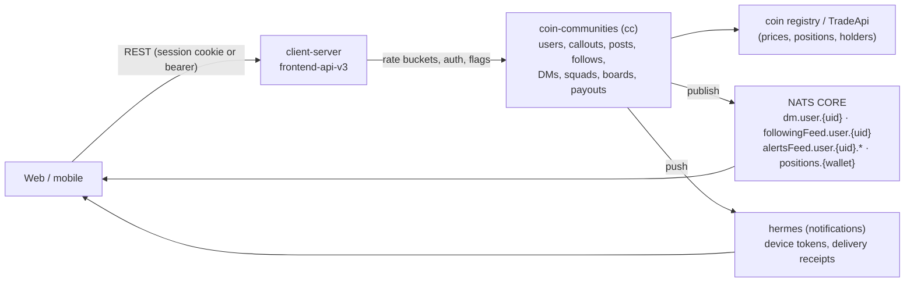

# Social layer: callouts, feeds, follows, DMs

pump.fun runs a social network inside the trading app. Its unit is the **callout**: a public call on a coin, backed by
a real position, which other users can reply to, quote, repost, like and "tail". Everything social is owned by one
upstream service the contract calls **coin-communities** (`cc`); `frontend-api-v3` (the contract's "client-server",
a BFF) authenticates, rate-limits and reshapes it [contract].

## Callouts

| Point | How it works | Source |
| --- | --- | --- |
| Create | `POST /callout/create` (multipart): `coinMint`, `thesis`, `version` 1 or 2, `chain` / `chainId`, `asGroupId` (post as a squad), `quotedCalloutId` (a quote callout), `mediaId` (a screened video or voice note, exclusive with an image part), `sourceRef` (`collectible:<opening_uuid>`: one callout per pack pull) | [contract] |
| Price stamp | A callout is "minted" at the coin's current price; with no price `cc` refuses (`PRICE_UNAVAILABLE`). The card later shows `calledOutAtMcap`, `multiple`, `maxMultiplier` against that stamp | [contract] [capture] |
| Gates | One live callout per user per coin (`DUPLICATE_CALLOUT`); an attempt budget (`ATTEMPT_LIMIT`); a write cooldown (`COOLDOWN`) and a separate spam throttle (`SPAM_RESTRICTED`); the caller must hold the coin (`INSUFFICIENT_BALANCE`) from a linked, non-reserved wallet (`NO_ELIGIBLE_WALLET`); a Mayhem coin only after its run ends (`MAYHEM_NOT_COMPLETED`); text moderation (`INVALID_CONTENT`, sent as 422) | [contract] error registry |
| Eligibility preflight | `GET /callout/eligibility/{coinMint}` answers `{eligible, preflight}` or the reason (`EXISTING_CALLOUT`, `ATTEMPT_LIMIT`) before the composer opens | [contract] |
| Chains | A callout can name a Solana or EVM coin, a HyperCore perp (`hlcore:mainnet`, the coin name such as `BTC` or `xyz:TSLA`), a TON jetton (`ton:-239`), a NEAR token (`near:mainnet`) or a Starknet token (`starknet:SN_MAIN`). Each chain is its own "arm" of the eligibility check | [contract] |
| Video | `POST /callout/media` uploads a video (50 MiB cap, 60 s, converted server-side). The client polls `GET /callout/media/{mediaId}` until screening marks it clean, then attaches the id. Budget: 5 uploads per 10 min, 30 a day; the BFF bucket allows 10/min | [contract] |
| Voice | `POST /callout/voice`: audio-only AAC m4a, 10 MiB, 120 s, transcribed synchronously; dark behind the flags `calloutVoiceUploads` (BFF) and `coinCommunitiesCalloutVoiceMedia` (cc) | [contract] |
| Replies, quotes | `POST /callout/{id}/replies` (multipart, nested via a parent reply); `GET /callout/replies/{replyId}/chain` returns the ancestor chain; a thread author can block repliers (`POST /blocks/{userId}`, `BLOCKED_BY_AUTHOR`) | [contract] |
| Reposts | `POST /callout/{id}/repost` (optionally a reply via `replyId`): the author reposts freely, anyone else must hold ≥ $1 of the token; idempotent toggle | [contract] |
| Likes, likers, reposters, tailers | Like/unlike on callouts and replies; `GET /callout/{id}/tailers` lists wallets that traded after the call | [contract] |
| Translation | `GET /callouts/{calloutId}/translation` translates into the caller's locale | [contract] |
| Stats | `GET /users/{address}/callout-stats`: peak-multiple hit rates, averages, time to peak, distribution per window; `GET /callout/leaderboard-stats/{userId}` | [contract] |
| Onboarding | `GET /callout/onboarding?os&country` serves a first callout to show a new user, from the referrer's calls (`REFERRER`) or a configured mint (`CONFIGURED_MINT`) | [contract] |
| Posts | A newer "posts" model (`GET /posts`, `/posts/{id}`, replies, quotes, likers, reposters) with one-level embeds; posts writes moved off the BFF in contract 0.321.0 | [contract] |
| Rewards | The Callout Rewards Program pays USDC to users ranked by an internal activity metric (engagement plus trading connected to their callouts), in daily payout rounds; a referrer gets a share of each referred earner's round. History: `GET /payouts?kind=reward`; board: `GET /payouts/leaderboard` (top 500, cached ≤ 60 s) | [site-docs `callout-reward-terms`] [contract] |

## Feeds

| Feed | Mechanism | Source |
| --- | --- | --- |
| Home (`GET /home-feed`) | Trending coins with a followed or featured trader's position and callout. Filters applied **before ranking** (current market-cap band, position cost-basis band) so a banded page still fills; asset-class filter applied after. `chains=` interleaves each chain's own ranking by rank under one cursor. `forceRefresh` skips a short ranking cache (pull to refresh). Signals sent: `session_id`, `device_id`, `session_start_timestamp_ms` | [contract] [capture] |
| New (`GET /home-feed/new`) | Every live-position-backed callout, newest first, no ranking; `GET /home-feed/new/count` counts arrivals after a pinned `since` for the "new posts" pill | [contract] |
| Alerts (`GET /following-positions/alerts`) | Everything followed accounts did as rows of nine kinds (callouts, updates, replies, quotes, reposts, trades, collectible legs, …), cursor-paged, page size clamped to 10. Chain filter applied inside the `cc` read over a 14-day scan window | [contract] |
| Live alerts | `POST /following-positions/alerts/presence` registers live presence with optional trade-size and market-cap bands and returns `{subject, heartbeatIntervalSeconds, presenceTtlSeconds}`: the exact NATS subject to consume. `cc` publishes stream events only for viewers with live presence; `DELETE` counts a stop and presence expires by TTL | [contract] |
| Following feed per coin | `GET /following-feed/by-mint/{mint}` | [contract] |
| Followed holders | `GET /followed-holders/{mint}` (accounts you follow that hold the coin), `/coins` (coins your follows hold), `/recent-entries` (coins your follows net-bought inside a server-set trailing window, at most 10), `/suggestions` | [contract] |
| Video feed | `GET /feed/video-feed`: curated stream clips and live coins | [contract] |

## Follow graph

- `POST /following/v2/{userId}` (with an `origin` tag) and `/following/v2/bulk`; the web client attaches an
  **AWS WAF token** (`x-aws-waf-token`) to follow writes [contract] [bundle].
- Reads moved to `/following/v3/*` (pages, search, counts), listed under the API scope `graph.read` [contract].
- Per-follow **trade notifications** on or off (`PUT/DELETE /following/{userId}/trade-notifications`, bulk variants)
  [contract].
- Suggestions: after following someone, accounts co-followed by that user's followers, tiered by PnL credibility,
  then filled from the daily PnL board (100-row ceiling); onboarding suggestions sampled from the PnL board [contract].
- `GET /users/{id}/mutual-followers`: "followed by people you follow" [contract].
- Mutes hide a user from For You; blocks stop them replying in your threads [contract].

## Direct messages

| Point | How it works | Source |
| --- | --- | --- |
| Who can DM | Mutual follow in both directions (`GET /dms/eligibility/{userId}`, refusal `NOT_MUTUAL`) | [contract] |
| Send | `POST /dms/to/{userId}/messages` (multipart image with `mediaWidth`, `mediaHeight`, `mediaBlurhash`); `cc` throttles sends (`RATE_LIMITED`) and screens media (`MEDIA_REJECTED`) | [contract] |
| Inbox | `GET /dms/inbox?filter=inbox|archived`, per-conversation archive, mute and pin prefs (`PATCH`), read pointer (`POST …/read`) | [contract] |
| Delivery | Realtime over NATS `dm.user.<uid>` with a per-user JWT; the client also tracks `INBOX_POLL`, `FOREGROUND_REFETCH` and `SEND_ECHO` delivery modes. A new message raises an in-app toast unless the room is open, the inbox is open or the conversation is muted | [contract] [bundle] |
| Push | hermes: `PUT v1/device-tokens {token, platform:"web", deviceId}` registers a web-push token (Firebase); `POST notifications/confirm-delivery` reports in-app delivery; deep links `pump://dms/…` | [bundle] |

## Identity decorations

- **Wallet labels**: a private label per wallet (`PUT /wallet-labels/{wallet}`), a cap per owner
  (`LABEL_LIMIT_REACHED`), and batch decoration with personal label, global label and registration state [contract].
- **Bookmarks**: folders of coins (`/bookmarks`, `/coins/bookmarks/{id}`) [contract].
- **Presence**: `sharesLastActive` on or off (`PATCH /presence/settings`) [contract].
- **Mentions**: `GET /users/mention-candidates` feeds the `@` composer [contract].
- **Verified badge**: KOL/influencer status (`/profiles/verified`), plus generated share media per profile (a PnL
  loop and a replay intro video) [contract] [capture].

## Reports and moderation

- `POST /reports`: report a coin, user, callout or reply with one or more reasons; one report per reporter per
  target; `details` required for "other"; self-reports refused (`SELF_REPORT`) [contract].
- Moderator routes: wallet bans, NSFW marks, photo and banner removal, verified flags, avatar removal, PnL-board bans
  and a mint blocklist, competition strikes; internal approvals for the "hot coin" surface and "quiet trending"
  notifications [contract]. Livestream rooms have their own moderators and bans
  (`chat/moderation/rooms/{mint}/bans|moderators`, `human-moderation/is-moderator`) [bundle].
- Coins carry a **security verdict** (`security_verdict {verdict, scope, reasons, decided_by, provider, version}`);
  a coin blocked everywhere is not served (`COIN_BLOCKED`), and the web app keeps scam-blacklist and warning-bypass
  mint lists behind flags [capture] [contract] [bundle].
