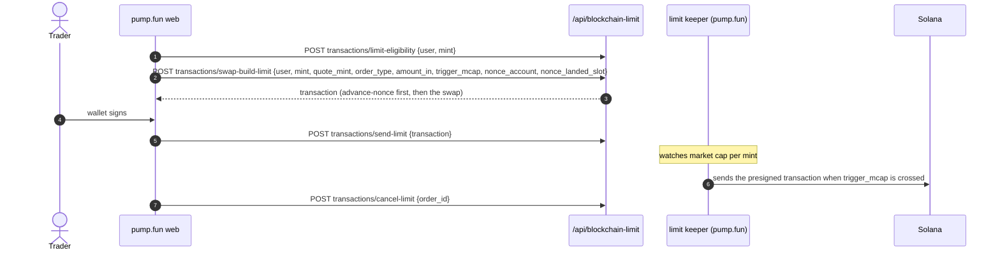

# Trading tools: limit orders, custom pairs, discovery, portfolio

## Limit orders (Solana): durable-nonce presigned swaps

There is no order-book program. A limit order is a swap transaction the user signs **in advance** against a durable
nonce account, so it never expires; pump.fun's server holds it and sends it when the coin's market cap reaches the
trigger [bundle] [inferred].

| Point | Detail | Source |
| --- | --- | --- |
| Order record | `order_address` (the id), `token`, amount and decimals, `trigger_price_usd`, `min_quote_out`, `deadline`, `created_at`, `executed_at`, settlement `{status, proceeds, payout_tx, payout_amount}`; states active, executing, success, cancelled, failure, expired | [bundle] |
| Nonce | The request carries `nonce_account` and `nonce_landed_slot`: the client first creates or reuses a durable nonce account and waits for it to land | [bundle] |
| Fee | The platform fee is charged when the order executes, at the rate in force when it was placed | [site-docs fees] |
| EVM | `/api/blockchain-limit/transactions/evm/<route>` with an order factory contract and a bridge leg; errors `factory_not_configured`, `bridge_unavailable`, `bridge_chain_unsupported` | [bundle] |
| Page | `/orders`; flag `webBlockchainLimitOrders` (2026-09-01) | [bundle] |

## Server-side send

Besides Nozomi and the Jito proxy, the builder service sends signed transactions itself:
`POST /api/blockchain/transactions/send {transaction | transactions[], route, options, non_trade_tx}` → `{signature}`.
Claims and other non-trade transactions use it; the client then polls `getSignatureStatuses` [bundle]. Requests to
the builder service carry `x-transaction-encoding` (`base64`) and auth headers, retry twice on 429 or 5xx with
600 ms → 1.2 s backoff, and time out at 30 s; its own error name is "blockchain-api-service" [bundle].

## Custom pairs

| Point | Detail | Source |
| --- | --- | --- |
| Quote list | `blockchain-swap /supported/coin-create-mints`: 226 quote assets with decimals, minimum buys in SOL and USDC, price, market cap, liquidity, asset type | [capture] |
| Terms | Each listed asset links its issuer's and listing provider's terms; RWA tokens carry issuer jurisdiction limits | [site-docs custom-pairs] |
| Fees | SOL and USDC pairs use the market-cap tiers; other pairs a flat schedule (curve 0.30% creator + 0.95% protocol; canonical pool 0.05% + 0.05% + 0.20% LP), or a creator-set holder-rewards rate | [site-docs fees] |
| Routing | A coin paired with another pump.fun coin trades through two pools; pump.fun's own interfaces charge the protocol fee once on the first pool and the creator (or holder) and LP fees once on the last | [site-docs fees] |
| Create | Coins on custom pairs go through a separate builder with a "prep swap" into the quote asset | [bundle] (see [../flows/create-coin.md](../flows/create-coin.md)) |
| On chain | `QuoteControl` holds starting reserves per quote mint (`set_quote_control_mint_reserves`) | [idl] [chain] |

## Discovery

| Surface | Mechanism | Source |
| --- | --- | --- |
| Boards | `GET /coins/boards/{board}`: fold-ranked lists with a `version` that bumps on every rank change and `as_of_ms`; up to 150 rows ("the AIA board window"); dark until `uapiCoinLists` is on; `503 degraded_lanes [trade_api.list_coins]` when TradeApi is down. The advanced-indexer `boards/trending` and `/ws/trenches` feed the live columns | [contract] [capture] |
| Hot coin | `GET /coins/hot-coin`, gated by moderator approval (`/internal/moderation/hot-coin/approvals/*`) | [contract] |
| Recommendations | `GET /coins/recommendations?surface=deposit_success|search_entry|first_buy_picks`: a ranking service with per-surface kill switch and deadline; experiments bucketed on `session_id`; impressions joined by `device_id`; rows stamped with ranking id and rank | [contract] |
| Search | `GET /coins/search-v2` (7-day recency), `/search-unrestricted`, quote facets; `GET /search/resolve?identifiers=` classifies 1–5 strings at once (mint, bonding curve or pool, wallet, username, …) and reports degraded legs | [contract] |
| Similar, great, top | `/coins/similar`, `/coins/great-coins`, `/coins/top-tokens/mints?withChains` | [contract] [capture] |
| Explore | `/explore` with a social terminal (`webExploreSocialTerminal`) and mixed search results | [bundle] |

## Portfolio

- `GET /user-portfolio/{userId}?filter=open|closed|all&sortBy`, `totalsOnly` for the summary; a wallet still being
  built answers `409 PORTFOLIO_BUILDING` and keeps building [contract] [capture].
- Dust floor per wallet (`/user-portfolio/dust-floor`), spam and "not spam" marks per mint that override the scam
  gate's verdict for the owner; low-quality holders (external custody, under 24 h old, under $5) are tagged so lists
  fold them behind "show more" [contract].
- `GET /portfolio-summary` merges Solana and linked EVM chains; `/portfolio-summary/chart` values tokens at trusted
  marks plus cash; `POST /portfolio-summary/balances` reads many wallets at once [contract] [capture].
- Live repricing (`portfolioLiveReprice`) rides the uapi stream (see [../backend/realtime.md](../backend/realtime.md))
  [bundle].

## Screening

- `GET /check/{address}` screens a wallet against a blocklist (the compliance service); a blocked wallet gets
  `statusCode 405` in the body, and screened wallets are refused writes (`WALLET_NOT_ALLOWED`) [contract].
- `GET /auth/is-valid-jurisdiction` and `GET /auth/disabled-features` gate features by region [contract].
