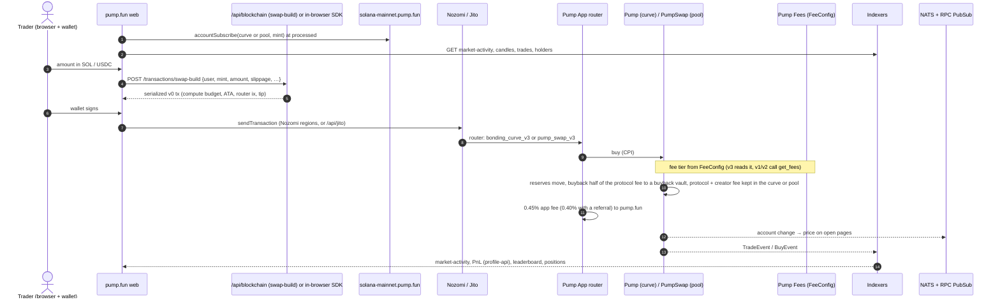

# Flow: buy

Covers both venues. Until graduation a buy hits the bonding curve; after it, the coin's canonical PumpSwap pool.
The web app sends app trades through the Pump App router, which charges the 0.45% platform fee [tx] [capture].

| Step | Detail | Source |
| --- | --- | --- |
| Prices before the trade | `swap-api /v1/coins/{mint}/market-activity`, `frontend-api-v3 /candles/{caip2}/{mint}`, curve or pool account through `accountSubscribe` (base64, `processed`) | [capture] |
| Build | `POST pump.fun/api/blockchain/transactions/swap-build` (`has_support_for_sending_options: true`, retries, `insufficient_funds`). The agents API `POST fun-block.pump.fun/agents/swap` picks curve or pool on the server and returns a transaction | [bundle] [docs pump-fun-skills] |
| Fees in the transaction | Priority fee from `getPriorityFeeEstimate` (floor 100,000 µlamports), compute limit from simulation, tip to a `pfn…` (Nozomi) or Jito account | [bundle] |
| Router | `bonding_curve_v3` → Pump (+ Pump Fees, Token-2022); `pump_swap_v3` → PumpSwap (+ Pump Fees, SPL Token, Token-2022) | [tx 2026-10-28] |
| Curve buy (v3) | 1.25% on top: 0.475% to a buyback vault in the trade, 0.475% protocol and 0.30% creator kept on the curve until swept | [chain] [tx] → [../onchain/fees.md](../onchain/fees.md) |
| Pool buy (v2) | Market-cap tier from `FeeConfig`: 1.25% below 420 SOL down to 0.30%; buyback half paid in the trade; protocol and creator fee kept in the pool | [chain] |
| App fee | `blockchain-swap /referrals/fee-rates`: 45 bps, 40 with a referral, 5 / 4 bps on 16 listed quote assets; shown back as `fee_detail.ui` | [capture] |
| Crossing buy | A v3 buy that empties the curve continues into the future pool's reserves (synthetic migration). See [graduate.md](graduate.md) | [docs `SYNTHETIC_MIGRATION.md`] |
| After | `profile-api /pnl/coin/{mint}/holders` (cost basis, fees split into base, priority, tip, ui, ata_rent, protocol), `frontend-api-v3 /mint-positions`, `/pnl-leaderboard`, NATS `positions.<wallet>` and `account_balance_change.<wallet>.*` for signed-in users | [capture] [contract] |

A buy sent straight to Pump or PumpSwap, as bots do, skips the router and its app fee [tx 2026-10-26, see
`../onchain/fees.md`]. Terminal sends `validate_nonce` + `route` through its own program [tx].
