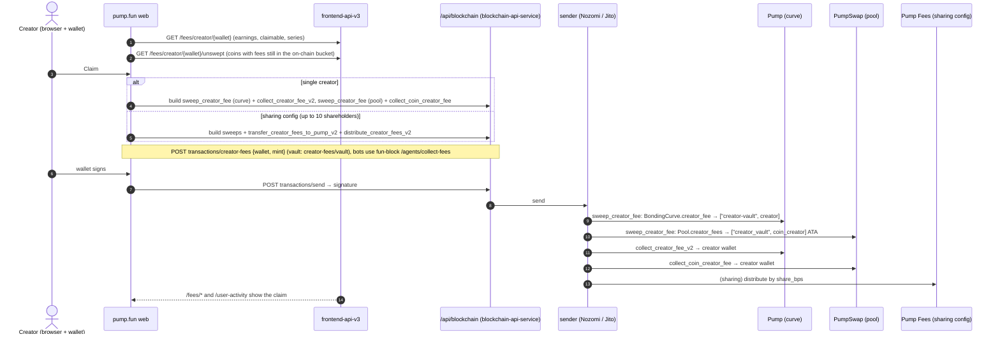

# Flow: claim creator fees

Since the October 2026 release, v3 curve trades and v2 pool trades keep the creator fee inside the curve or pool. A
claim therefore has two parts: sweep the fee out of each curve or pool, then pay it to the creator, or split it among
shareholders.

| Step | Detail | Source |
| --- | --- | --- |
| What is owed | `GET /fees/creator/{address}` ("fee earnings, claimable balance and series"), `GET /fees/creator/{address}/unswept` ("creator fees still in the on-chain bucket … what a claim must sweep"), `GET /fees/coin/{chainId}/{address}` (sharing config and fee events), `GET /fees/shareholder/{id}` | [contract] |
| Sweep | `sweep_creator_fee` on Pump and on PumpSwap, permissionless. pump.fun runs the protocol-fee sweep itself | [idl] [docs `SWEEP_FEES.md`] |
| Pay out, single creator | Curve side `collect_creator_fee_v2` (creator vault → wallet); pool side `collect_coin_creator_fee` | [idl] [docs `COLLECT_CREATOR_FEE.md`] |
| Pay out, sharing config | `transfer_creator_fees_to_pump_v2` (pool fees into the Pump creator vault), then permissionless `distribute_creator_fees_v2` by `share_bps`; `get_minimum_distributable_fee` checks the minimum | [idl] [docs `CREATOR_FEE_SHARING.md`] |
| GitHub-linked shareholders | Their share accrues in a `SocialFeePda`; `claim_social_fee_pda` is signed by pump.fun's `social_claim_authority` "only through Pump.fun (web or mobile)" | [idl] [docs] |
| Holder-rewards coins | The creator is the `["holder-rewards", mint]` PDA; pump.fun's `holder_reward_claim_authority` pays holders with `distribute_fee_to_holders(amounts)`; the book is at `GET /fees/holder-rewards` | [idl] [contract] |
| Builder (web app) | The Claim button calls `POST /api/blockchain/transactions/creator-fees {wallet, mint}`, which returns `{fees: {claim_transaction (base64 v0), is_claimable, transactions[]}}` with the sweeps prepended; `POST transactions/creator-fees/vault {wallet}` (no mint) returns a `collect_transaction` for the whole creator vault. The signed transaction goes back through `POST transactions/send {transaction, route, options, non_trade_tx}` → `{signature}`, and the app polls `getSignatureStatuses` every 2 s | [bundle 2026-10-28] |
| Builder (bots) | `POST fun-block.pump.fun/agents/collect-fees` builds the same claim for agents ("collect for direct creator, distribute for sharing config") and returns `{transaction, creator, isGraduated, usesSharingConfig}` | [docs pump-fun-skills `coin-fees/SKILL.md`] [sdk] |
| Terms | `GET/POST /creator-rewards-tos(/accept)`: the creator-rewards terms acceptance the app records | [contract] |
