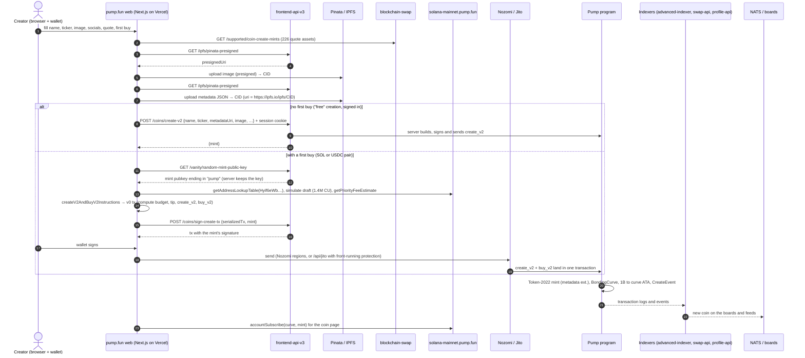

# Flow: create a coin

Three ways in. The web app's two paths come from its bundle; the agents API comes from pump.fun's published skills.
Program steps are from the IDL and docs, and the indexer side from captured API shapes. Tags are defined in
[../sources.md](../sources.md).

## Steps and where each fact comes from

| # | Step | Detail | Source |
| --- | --- | --- | --- |
| 1 | Quote options | `GET blockchain-swap.pump.fun/supported/coin-create-mints`: SOL, USDC, stocks and other quote assets with prices and minimum buys | [capture] |
| 2–6 | Media and metadata | Presigned Pinata uploads from the browser; `metadataUri = https://ipfs.io/ipfs/<cid>`; gateway `pump.mypinata.cloud` | [bundle] [contract] |
| 7–9 | Free creation | `POST /coins/create-v2` ("Create a coin without captcha"); the app records `isFree: true, tokensBought: 0`. No wallet signature is requested on this path, so the server signs and pays | [contract] [bundle]; signer and payer [inferred] |
| 10–11 | Vanity mint | `GET /vanity/random-mint-public-key`, from a pool the server checks with `GET /coins/check-vanity-store/{mint}` | [contract] [bundle] |
| 12–13 | Client build | `PUMP_SDK.createV2AndBuyV2Instructions({global, mint, name, symbol, uri, creator, user, amount, quoteAmount, mayhemMode, quoteMint})`, lookup table `Hyif6eWb…`, CU = simulated × factor ≤ 1.4M, priority fee from `getPriorityFeeEstimate` | [bundle] |
| 14–15 | Mint signature | `POST /coins/sign-create-tx` returns the transaction with the vanity key's signature. Without a vanity key, the browser signs with a fresh mint keypair | [contract] [bundle] |
| 16–18 | Sign and send | Wallet signs; sent to 7 Nozomi regions with a tip to a `pfn…` address, or to `/api/jito` with a Jito tip and `jitodontfront…` | [bundle] |
| 19 | On chain | `create_v2`: Token-2022 mint with MetadataPointer + TokenMetadata (no authorities), `BondingCurve` from `Global` (30 SOL / 1.073 B virtual, 793.1 M for sale), 1 B minted to the curve's ATA, Mayhem accounts passed, `CreateEvent`. `buy_v2` in the same transaction | [idl] [chain] [docs `COIN_CREATION.md`] |
| 20–21 | Indexing | The coin appears in `coins-v3`, `boards/trending`, `home-feed`, `in-memory-coin` (with `sniperCount`, `numKolsTraded`, …) | [capture] |
| 22 | Live page | `accountSubscribe` at `processed` on the curve and mint over pump.fun's RPC WebSocket | [capture] |

**Other creation paths.** Custom pairs (stocks, pump coins as quote, a custom creator fee, holder rewards) use a
separate builder that first swaps into the quote asset ("prep swap") [bundle]. Coins with creator-reward recipients
add a fee-sharing transaction (`create_fee_sharing_config` + `update_fee_shares_v2`), sent with front-running
protection [bundle] [idl]. The App router has `create_coin_and_buy_bonding_curve_v2` [sdk-bin]. Outside the web app,
`POST fun-block.pump.fun/agents/create-coin` returns a create + first-buy transaction already signed by a mint key
the server generated [docs pump-fun-skills].
