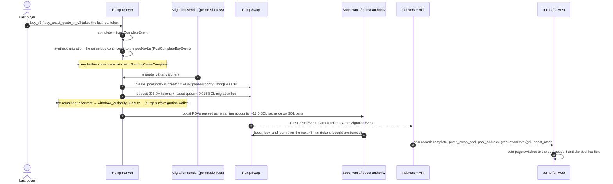

# Flow: graduate to PumpSwap

| Step | Detail | Source |
| --- | --- | --- |
| Completion point | Curve from `Global`: 793.1 M tokens for sale, about 85.005 SOL raised net of fees, market cap ≈ 410.9 SOL at completion | [chain] → [../onchain/lifecycle.md](../onchain/lifecycle.md) |
| Synthetic migration | A v3 crossing buy has no maximum: it takes what is left, sets `complete`, then buys from the tokens and quote the migration will deposit, priced by PumpSwap's formula. It is recorded as `post_complete_base_out` / `post_complete_quote_in`. Mayhem curves are excluded | [docs `SYNTHETIC_MIGRATION.md`] |
| Who migrates | `migrate_v2` is permissionless. The live migration of 2026-10-26 was sent by `9C4nRvhhVquCKATjDCx5FKvNS9PNgNqgyWy9AcoDjYv5` | [idl] [tx `3APwkHCt…`] |
| Pool | Canonical pool `["pool", 0u16, pool_authority, base_mint, quote_mint]`. LP tokens are minted to the pool-authority's account (the docs call them burnt) | [idl] [docs] |
| Fee | `pool_migration_fee` 15,000,001 lamports: rent for the new accounts, the rest to `39azUYFW…` (8,822,721 lamports in that transaction) | [chain] [tx] |
| Boost | On by default since 2026-07-21: about 20% of migration liquidity (17.6 SOL on SOL pairs) spent by `boost_authority` `HTVZVEQM…` on TWAP buys that are burned. The pool keeps pricing as if that SOL were still in the vault | [chain] [press: The Block 2026-07-29] [sdk] |
| After | Pool trades use market-cap tiers (1.25% → 0.30%); creator fees continue in the pool; the indexer records `gd` / `graduationDate` and `pump_swap_pool` | [chain] [capture] |
