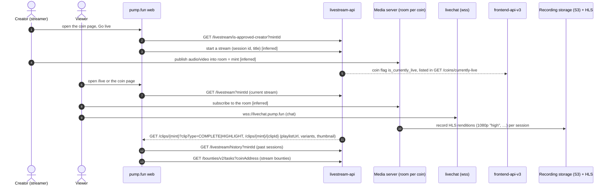

# Flow: a livestream

Entirely off chain apart from the coin it belongs to. Viewer-side requests were captured. The streamer side was not
exercised (it needs a signed-in, approved creator), so those steps come from the API shapes and are marked.

| Step | Detail | Source |
| --- | --- | --- |
| Who may stream | `GET /livestream/is-approved-creator?mintId` → `{isApprovedCreator}` | [capture] |
| Live list | `GET frontend-api-v3/coins/currently-live`; `/live` is server-rendered (RSC) and made no client API call | [contract] [capture] |
| Room | `roomName` is the coin's mint; sessions have numeric ids (e.g. 2,612,298) and titles | [capture] |
| Recording | `clipId = <start>:<sessionId>`; HLS `playlistUrl` and `variants[{name, height, playlistUrl, playlistS3Key}]`, `mp4S3Key`, `thumbnailUrl`, `viewCount`, `deletionStatus` | [capture] |
| Chat | `wss://livechat.pump.fun` plus REST on `https://livechat.pump.fun` with the session cookie | [config] [bundle] |
| Moderation | `livestream_ban_expiry` on the coin; clips `hidden` / soft-deleted counts | [capture] |
| Bounties | Tasks per coin with phases `OPEN`, `PENDING_RESOLUTION`, `IN_DISPUTE_PERIOD`, `CLOSED`; page `/bounties/[taskId]` | [capture] [bundle] |
| Media server | Not named in any viewer request. The room/session/S3 vocabulary matches a LiveKit-style service | [inferred] |
