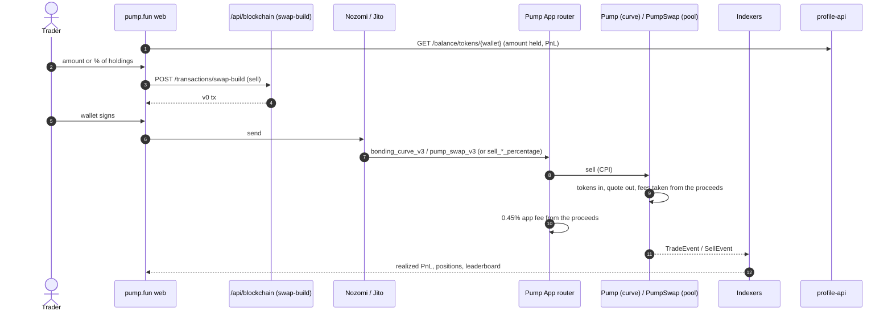

# Flow: sell

The same path as [buy.md](buy.md), mirrored. What differs is listed here.

| Point | Detail | Source |
| --- | --- | --- |
| Percentage sells | The router has `sell_bonding_curve_percentage` and `sell_pump_swap_percentage`, so "sell 50%" resolves on chain against the live balance | [sdk-bin] |
| Curve sell (v3) | Protocol (0.95%) and creator (0.30%) fees come out of the SOL proceeds and stay on the curve until swept; buyback half paid in the trade | [tx `47iBM7BC…` in `../onchain/fees.md`] [docs `TRADE_V3.md`] |
| Pool sell | A sell paying out more than the quote vault really holds fails with `InsufficientRealQuoteReserves` (boost and negative virtual reserves make the priced reserve differ from the real one) | [sdk `math/amm.rs`] |
| Completed curve | After the crossing buy and before `migrate_v2`, every curve trade fails with `BondingCurveComplete` | [docs] |
| After | `profile-api` `realized` PnL, `frontend-api-v3 /user-portfolio/{wallet}` (`isExited`), `/portfolio-summary` | [capture] |
| Holders' view | Holder lists tag the dev, snipers, bundlers and the LP (`/coins/holder-stats/{mint}`: "top-10 / dev / sniper / bundler share") | [contract] |
