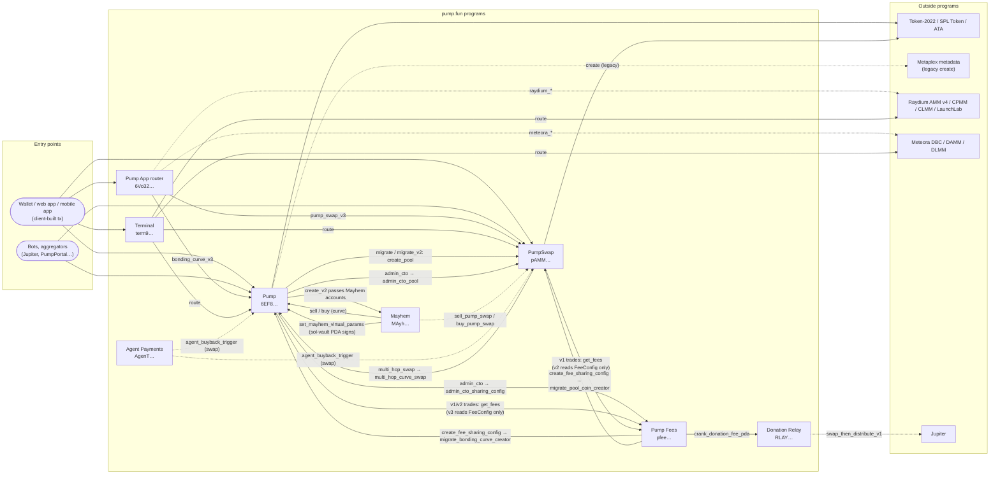

# CPI graph

Which program calls which. Solid edges are written into an IDL (a fixed program address in an instruction's account
list, or a PDA of another program as signer) or seen as inner instructions in a decoded transaction. Dashed edges
come from SDK source or the program binaries.

## The edges and their evidence

| Caller → callee | Instruction | Evidence |
| --- | --- | --- |
| Pump → PumpSwap | `migrate`, `migrate_v2` call `create_pool` (index 0, creator = `["pool-authority", mint]`) | [idl] `pump_amm` program account in the migrate account list; [tx `3APwkHCt…`] `CreatePoolEvent` inside the migration |
| Pump → PumpSwap | `admin_cto` calls `admin_cto_pool`, signed by `["pool-authority", mint]` | [idl] signer PDA of Pump in `admin_cto_pool` |
| Pump → Pump Fees | `admin_cto` calls `admin_cto_sharing_config` | [idl] |
| Pump, PumpSwap → Pump Fees | Pump v1 and v2 trades and PumpSwap v1 trades pass `fee_program` (`pfee…`) and call it for the fee tier (`get_fees`); Pump v3 and PumpSwap v2 trades (17 accounts) pass only `fee_config` and read it without a call | [idl] account lists of `buy`, `buy_v2`, `buy_v3`; [tx] Pump Fees appears as an inner program under Mayhem `sell` and router `bonding_curve_v3` on 2026-10-28, so those reach a v1/v2 trade path |
| PumpSwap → Pump | `multi_hop_swap` calls `multi_hop_curve_swap`, which only the `["global_config"]` PDA of PumpSwap can sign | [idl] |
| Pump Fees → Pump, PumpSwap | `create_fee_sharing_config` moves the creator to the config with `migrate_bonding_curve_creator` / `migrate_pool_coin_creator` | [idl] [docs `CREATOR_FEE_SHARING.md`] |
| Pump Fees → Donation Relay | `crank_donation_fee_pda` forwards a donation PDA's balance | [idl] [sdk `pda.ts`] |
| Pump → Mayhem | `create_v2` passes `mayhem_program_id`, `global_params`, `sol_vault`, `mayhem_state`, `mayhem_token_vault` | [idl] [docs `COIN_CREATION.md`] |
| Mayhem → Pump | `set_mayhem_virtual_params`, signed by Mayhem's `["sol-vault"]` PDA | [idl] |
| Mayhem → Pump | Mayhem `sell` trades the curve (inner programs Pump, Pump Fees, Token-2022) | [tx 2026-10-28, `../data/extra-snapshot.json`] |
| Mayhem → PumpSwap | `buy_pump_swap`, `sell_pump_swap` | [sdk-bin] names only |
| App router → Pump | `bonding_curve_v3` (inner Pump, Pump Fees, Token-2022) | [tx 2026-10-28] |
| App router → PumpSwap | `pump_swap_v3` (inner PumpSwap, Pump Fees, SPL Token, Token-2022) | [tx 2026-10-28] |
| App router → Raydium, Meteora, OpenBook | `raydium_amm/cpmm/clmm/launchlab`, `meteora_dbc/damm/dlmm`; the local validator loads Raydium AMM v4 and OpenBook "because the router CPIs into Raydium's SOL/USDC pool" | [sdk-bin] [sdk `pump_config.rs`] |
| Terminal → PumpSwap, Pump, Raydium CPMM/CLMM, Meteora DLMM | `route` | [tx 2026-10-28] |
| Agent Payments → swap venue | `agent_buyback_trigger(swap_instruction_data)` executes a swap the buyback authority supplies | [idl], venue not fixed |
| Donation Relay → Jupiter | `swap_then_distribute_v1` | [idl, on-chain IDL] |

`transfer_hook_authority` (`333UA891…`) has no instructions and calls nothing. See
[transfer-hook-authority.md](transfer-hook-authority.md).
