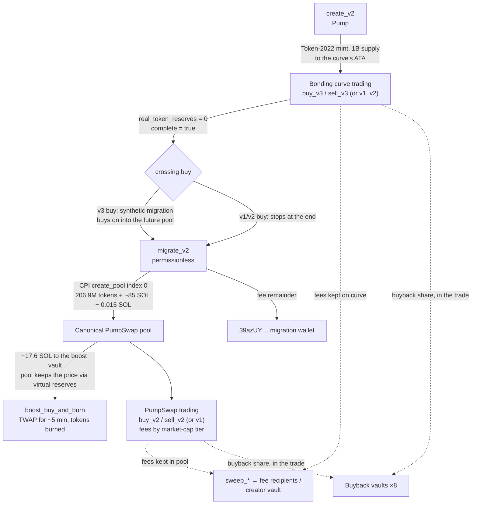

# A coin's life: create → curve → graduation → PumpSwap

Each step names the instruction, the accounts it touches and what moves. Program details are in
[`programs/`](), lamport splits in [fees.md](fees.md).

## The curve, in numbers

From the live `Global` [chain]. Constant product on virtual reserves, `k = 1,073,000,000 tokens × 30 SOL`:

| Point | Virtual tokens | Virtual SOL | Real SOL in curve | Market cap (1B supply) |
| --- | --- | --- | --- | --- |
| Creation | 1,073,000,000 | 30 | 0 | 27.96 SOL |
| Completion (793.1M sold) | 279,900,000 | 115.0054 | **85.0054** | 410.88 SOL |
| Pool at migration | 206,900,000 base | 84.9904 quote | n/a | 410.78 SOL |

The 85.0054 SOL is net of fees; buyers pay 1.25% on top (see [fees.md](fees.md)). The pool opens at the curve's last
price, minus the 0.015 SOL migration fee. These are computed values; the observed KIMCHI and live migrations are below.

## 1. Create: `create_v2` (Pump)

Accounts, in order [docs `COIN_CREATION.md`] [idl]:
`mint` (new keypair, signer), `mint_authority` `["mint-authority"]`, `bonding_curve` `["bonding-curve", mint]`,
`associated_bonding_curve`, `global`, `user` (signer, payer), `system_program`, `token_program` (Token-2022),
`associated_token_program`, `mayhem_program_id`, `global_params`, `sol_vault`, `mayhem_state`, `mayhem_token_vault`,
`event_authority`, `program`. Optional remaining accounts select the quote mint: `quote_mint`,
`associated_quote_bonding_curve`, `quote_token_program`.

What happens: the mint gets 6 decimals and Token-2022 metadata, 1,000,000,000 tokens are minted to the curve, the
curve takes `Global`'s starting reserves, and `creator` is recorded. The creator is the argument, or the
holder-rewards PDA for holder-rewards coins, and it does not have to sign. `CreateEvent` is emitted. Coin creation
costs only rent; `create_v2` has no creation fee argument or fee account [idl].

A first buy can go in the same transaction (`createV2AndBuyV2Instructions` in the SDK) [sdk]. Nothing on chain limits
how much of the curve one buyer takes. Press reports KIMCHI's deployer bought the whole curve in its creation
transaction [press]; the curve's record of a buy that ran past the end is in step 3.

Optional at creation: a sharing config (`create_fee_sharing_config` + `update_fee_shares_v2`, Pump Fees), making the
config the creator. The split can be set once.

## 2. Trade on the curve

v3 (current, 17 accounts) [docs `TRADE_V3.md`]: `global`, `base_mint`, `quote_mint`, `base_token_program`,
`quote_token_program`, `bonding_curve`, `associated_base_bonding_curve`, `associated_quote_bonding_curve`, `user`,
`associated_base_user`, `associated_quote_user`, `user_volume_accumulator`, `fee_config`
(`8Wf5TiAheLUqBrKXeYg2JtAFFMWtKdG2BSFgqUcPVwTt`), `buyback_fee_recipient`, `system_program`, `event_authority`,
`program`.

Per buy: the trade amount moves to the curve's reserves. The fee (95 + 30 bps) is charged on top. The buyback half of
the protocol fee goes to a buyback vault in the same instruction, and the rest of the protocol fee and the creator
fee are added to `BondingCurve.protocol_fees` / `.creator_fee`. v1/v2 instructions pay all fees out immediately
instead. Real example: [fees.md](fees.md#bonding-curve-trade).

## 3. Completion and graduation

- **Crossing buy.** The buy that takes the last real token sets `complete = true` and emits `CompleteEvent`. With
  `buy_v3` / `buy_exact_quote_in_v3` it continues into the tokens the pool will receive, priced as the pool would
  price them (`PostCompleteBuyEvent`) [docs `SYNTHETIC_MIGRATION.md`].
  KIMCHI's curve shows such a crossing: `post_complete_base_out` = 767,833.104148 tokens,
  `post_complete_quote_in` = 0.316585288 SOL [chain, curve `AZH6jz4fhwsT5U7zxymS62MEQ64LYsYsDL2atWmr9T7H`].
- **`migrate_v2`** (27 accounts, permissionless). Main accounts: `global`, `withdraw_authority` (writable, must equal
  `Global.withdraw_authority`), `base_mint`, `quote_mint`, `bonding_curve` and its two token accounts, `user` (signer),
  `pump_amm`, `pool` `["pool", 0u16, pool_authority, base_mint, quote_mint]` @PumpSwap, `pool_authority`
  `["pool-authority", base_mint]`, its base and quote accounts, `amm_global_config`, `lp_mint`,
  `user_pool_token_account` (pool-authority's LP account), pool vaults, token programs, `rent`, event authorities.
  Remaining accounts: boost vault authority and boost vault [sdk `pump_v2.rs`, `sdk.ts`]; the IDL does not list them.
- **What moves, on a live migration** [tx `3APwkHCtx3MRppKWFWMvipUh9p82cBDYN4DdXKyp3HSWJ5TfQqW82gAZM5eKR97PsDtV86cjscriPiw8Wcv2ZkM6`,
  2026-10-26 04:10:30 UTC, a mayhem coin, sent by `9C4nRvhhVquCKATjDCx5FKvNS9PNgNqgyWy9AcoDjYv5`]:
  the curve's 206.9M tokens and its SOL went into the new pool `77XeTL4R…`. Of the 15,000,001-lamport
  `pool_migration_fee`, 6,177,280 paid rent for the pool's new accounts and **8,822,721 went to `39azUY…`**
  ("Pump.fun: Migration"). Events: PumpSwap `CreatePoolEvent`, Pump `CompletePumpAmmMigrationEvent`.
- **Boost.** For boosted coins the migration also sets up the boost vault. About 17.6 SOL of the raised SOL is set
  aside and `boost_buy_and_burn` spends it within ~5 minutes, burning the coins bought [press: The Block 2026-07-29].
  The pool keeps a matching positive virtual quote reserve [chain: KIMCHI pool, 17.58 SOL]. See
  [programs/pump-amm.md](pump-amm.md#boost).

## 4. Trade on PumpSwap

v2 (17 accounts) or v1 (21–23). The canonical pool's fee comes from `FeeConfig` tiers by market cap: 2 / 93 / 30 bps
(LP / protocol / creator) below 420 SOL, 20 / 5 / 95 bps from 420 SOL, the creator share falling to 5 bps at 98,240
SOL and above. Half the protocol fee goes to a buyback vault in the trade. v2 keeps the rest of the protocol fee and
the creator fee in the pool's quote vault until swept. Real example: [fees.md](fees.md#pumpswap-trade).

## 5. Creator gets paid

- Single creator: Pump `sweep_creator_fee` → `collect_creator_fee_v2` (curve side). PumpSwap `sweep_creator_fee` →
  `collect_coin_creator_fee` (pool side).
- Sharing config: sweeps → `transfer_creator_fees_to_pump_v2` → `distribute_creator_fees_v2` (permissionless, by
  `share_bps`).
- Holder rewards: sweeps → holder-rewards PDA → `distribute_fee_to_holders`, signed by pump.fun's
  `holder_reward_claim_authority` with amounts it computes.
- Takeover: `admin_cto` (pump.fun key) can move all of the above to a new creator.

[docs `SWEEP_FEES.md`, `COLLECT_CREATOR_FEE.md`, `CREATOR_FEE_SHARING.md`, `HOLDER_REWARDS_README.md`]

## Re-verified 2026-10-28

The parameters behind every step above are unchanged at slot 462,377,442 [chain]. The same lifecycle, drawn across
frontend, API, chain and indexer, is in [../flows/](../flows/).
