# How pump.fun's backend is built: a reconstruction

This folder answers "how did they build the backend?". It is a reconstruction: the service names, protocols, error
shapes and limits come from evidence (the API contract, the web bundle, captured traffic, DNS, docs), and the way the
pieces fit is reasoned from that evidence. Every row says which. The last page is a build blueprint for the same
system.

| Page | What it covers |
| --- | --- |
| [services.md](services.md) | Every backend service by name, what it owns, its interface and the evidence for it |
| [data-pipeline.md](data-pipeline.md) | Chain ingest → ordered events → stores → folds → push (NATS, uapi stream, RPC PubSub) and the data model |
| [keepers-and-signers.md](keepers-and-signers.md) | The jobs that hold keys or move money: holder rewards, buybacks, limit orders, Mayhem, agents, payouts, bounty escrow |
| [blueprint.md](blueprint.md) | The same system laid out to build: repository, contracts, schemas, subjects, jobs, deployment, build order |

## The architecture in one picture

```mermaid
flowchart TB
    subgraph edge["Edge"]
        CF["Cloudflare<br/>(bot challenge, WAF)"]
        AWSWAF["AWS WAF token<br/>(follow writes)"]
        VER["Vercel: Next.js web<br/>/api/* same-origin proxies"]
    end

    subgraph bff["BFF layer (TypeScript, NestJS)"]
        CS["client-server = frontend-api-v3<br/>contract, auth, rate buckets, flags,<br/>degraded lanes, publicRead scopes"]
        KEYED["api.pump.fun<br/>keyed data plane"]
        STREAM["uapi stream gateway<br/>wss://frontend-api-v3/stream<br/>protobuf pumpfun.trading.v1"]
    end

    subgraph core["Domain services"]
        CC["coin-communities (cc)<br/>users, social, squads, boards,<br/>competitions, payouts, packs catalog"]
        TRADE["TradeApi<br/>coins, holders, fees, candles,<br/>positions, perps orders"]
        COIN["coin-service / coin registry<br/>(coinsGrpc), coin-details-api"]
        PROF["profile-service / profile-api<br/>balances, PnL"]
        LIVE["livestream-service<br/>(livestream-api): streams, clips,<br/>bounties, X connection"]
        CHAT["livechat"]
        HERMES["hermes<br/>notifications"]
        COMP["compliance-service<br/>wallet screening"]
        RANK["ranking service<br/>feeds, recommendations"]
        FILE["file-service<br/>uploads, Pinata, S3"]
    end

    subgraph tx["Transaction services"]
        BAS["blockchain-api-service<br/>(/api/blockchain): swap, claims,<br/>perps, packs, relay buys, send"]
        LIM["blockchain-limit<br/>limit orders + keeper"]
        BSW["blockchain-swap<br/>fee rates, quote assets"]
        FUN["fun-block<br/>agents API"]
        INT["intents<br/>bridge API (Relay)"]
        RPCP["rpc-proxy-worker<br/>solana / ink / arc RPC"]
    end

    subgraph data["Data plane"]
        ING["chain ingest<br/>(processed + confirmed)"]
        IDX["advanced-indexer · swap-api ·<br/>advanced-api-v2"]
        NATS["NATS ×4 (AWS us-east-1)<br/>auth-callout worker"]
        REDIS["Redis<br/>counters, caches, verdicts"]
        BQ["BigQuery<br/>analytics, 90-day usage"]
        S3["S3 + CloudFront<br/>media, clips, videos"]
    end

    subgraph ext["Vendors"]
        PRIVY["Privy"]
        CODEX["Codex (market data)"]
        RELAY["Relay"]
        HL["Hyperliquid"]
        LK["LiveKit"]
        SEND["Nozomi · Jito"]
    end

    CF --> VER --> CS
    CF --> KEYED --> CS
    CS --> CC & TRADE & COIN & PROF & LIVE & HERMES & COMP & RANK & FILE
    VER --> BAS & LIM & INT
    STREAM --> TRADE
    ING --> IDX & TRADE & CC
    TRADE & CC --> NATS
    CC --> REDIS
    CS --> REDIS
    CC & CS --> BQ
    BAS --> SEND
    BAS --> HL & RELAY
    INT --> RELAY
    CC --> CODEX
    CS --> PRIVY
    LIVE --> LK & S3
```

## What the evidence says about how it is built

| Trait | Evidence | Reading |
| --- | --- | --- |
| A BFF in NestJS | Errors are Nest's envelope `{statusCode, timestamp, path, error, message}` with reason phrases ("Bad Request"); the contract calls itself "client-server" and names its guards (`OptionalAuthGuard`); POSTs on profile-api and swap-api answer 201, Nest's default | The app-facing APIs are TypeScript NestJS services [contract] [capture] [inferred] |
| One typed contract for web, mobile and the public API | `defineRoutes({"METHOD /path": {summary, params, query, body, multipart, response, errors, emits}})` with zod; React Native upload checks; `publicRead(scope, …)`; a 106-code error registry with owners; a 90-day deprecation rule; version 0.321.0 named in a schema note | A shared contract package drives the server routes, the clients and the public docs [contract] |
| gRPC behind the BFF | Upstream errors quoted as `cc INVALID_ARGUMENT`, `cc NOT_FOUND`; `coinsGrpc` routes; "TradeApi GetHolders / GetOpenOrders"; lanes named `trade_api.get_fees`, `trade_api.list_coins` | Domain services speak gRPC (status codes, Pascal-case methods); the BFF maps them to HTTP [contract] [inferred] |
| Protobuf streaming | `STREAM_PROTOCOL "pumpfun.trading.v1"`, `Frame.fromBinary`, `WatchRequest.toBinary`, parts MARKET/PHASE/META/POSITION/HOLDERS/MARKS/CANDLES, frame kinds SNAPSHOT/LIVE/CORRECTION, commitments PROCESSED/CONFIRMED | A protobuf trading data model shared by TradeApi and a WebSocket gateway [bundle] |
| Event ordering | `OrdinalKey <blockId>-<txIndex>-<eventIndex>-<blockTimeMs>` on fee events; `slotIndexId` on trades; `ordinalKey()` in the stream client | Every chain event gets a total order key at ingest [contract] [bundle] |
| Periodic folds | "fold-ranked" boards with a `version`; "no fold is published"; holder-rewards book "open-day fold every 60 s"; boards `builtAtMs` | Aggregates are materialized by scheduled jobs, not computed per request [contract] |
| Partial failure as data | `503 degraded_lanes [...]`, `degraded: ["coin_upstream", …]` in search, `marks_degraded` in packs | The BFF fans out to "lanes" and reports which failed [contract] |
| Flags everywhere | LaunchDarkly streaming; a code registry of 95 flags with created/expires/exit criteria; server flags that make routes 404 or "dark" | Trunk-based rollout behind flags on both sides [bundle] [contract] |
| AWS + Cloudflare | NATS ELBs in us-east-1; `x-aws-waf-token`; S3 media URLs; CloudFront for clips and images; Cloudflare on every API host | Compute on AWS us-east-1, Cloudflare at the edge, Vercel for the web [dns] [bundle] |
| Redis and BigQuery | "usage from the Redis counters", "90d from BigQuery", verdict caches | Hot counters in Redis, warehouse in BigQuery [contract] |
| Codex | "Codex network id" (`1399811149` for Solana) in social records | Multichain prices and token metadata from Codex [contract] |
| Internal names | `client-server`, `coin-communities`, `TradeApi`, `coin-service`, `coin-details-api`, `profile-service`, `livestream-service`, `blockchain-api-service`, `compliance-service`, `rpc-proxy-worker`, `file-service`, `eep-core`, the auth-callout worker, a ranking service | Named in contract text and the chain registry's notes [contract] [bundle] |
