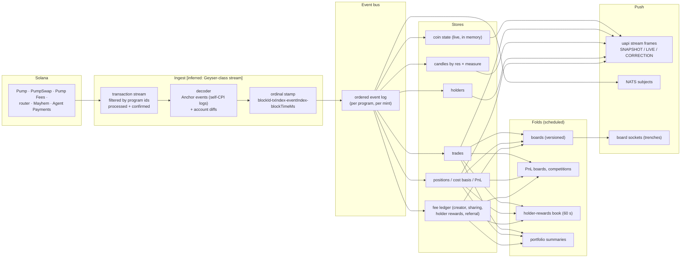

# Data pipeline: from a Solana slot to a pixel

## Stage by stage

| Stage | What happens | Evidence |
| --- | --- | --- |
| Subscribe | Transactions touching pump.fun's programs are read twice: at `processed` for speed and at `confirmed` for truth | Stream frames carry `Commitment.PROCESSED` / `CONFIRMED`; the web subscribes to accounts at `processed` [bundle] [capture] |
| Decode | Anchor events (`TradeEvent`, `CreateEvent`, `CompleteEvent`, PumpSwap `BuyEvent` / `SellEvent` / `CreatePoolEvent`, fee and sharing events) emitted by self-CPI, plus account state for curves and pools | Event lists in the IDLs [idl] |
| Order | Each event gets a total order: block, transaction index, event index, block time. Trades carry `slotIndexId`; fee events an `OrdinalKey`; the stream client keeps `blockId:txIndex:eventIndex` | [contract] [capture] [bundle] |
| Correct | A frame seen at `processed` that changes or disappears by `confirmed` goes out as a `CORRECTION` frame; clients replace by ordinal | `FrameKind.CORRECTION` [bundle] [inferred] |
| Fan out | Ordered events feed: the trade tape (`/trades/{chain}/{address}`), candles (`/candles/{chain}/{address}`, line view LTTB-capped), holders (`token-holders/{mint}/count`, `top-holders-v2`), positions and PnL (`mint-positions`, `user-portfolio`, profile-api), the fee ledger (`/fees/*`) | [contract] [capture] |
| Fold | Scheduled jobs materialize boards (with a `version` that bumps on every rank change), PnL boards per period, competition boards (frozen at the end), the holder-rewards book (every 60 s), callout-reward rankings (daily rounds) | [contract] |
| Push | uapi frames to open pages; NATS subjects for user-scoped and EVM data; board sockets for the live columns; Solana PubSub straight from pump.fun's RPC for curve and pool accounts | [bundle] [config] [capture] |
| Shadow reads | `candlesShadowReadPercent` (2026-10-12): a percentage of candle reads also go to a new store to compare | [bundle flag registry] [inferred] |

## The uapi stream protocol

| Item | Value | Evidence |
| --- | --- | --- |
| URL | `wss://frontend-api-v3.pump.fun/stream` (`NEXT_PUBLIC_UAPI_STREAM_URL`) | [bundle] |
| Encoding | protobuf, package `pumpfun.trading.v1`; client sends `WatchRequest`, receives `Frame` | [bundle] |
| Topic cases | `coin`, `wallet`, `list` | [bundle] |
| Parts per coin | `MARKET`, `PHASE` (curve / graduated), `META`, `POSITION` (needs a token), `HOLDERS`, `MARKS`, `CANDLES` (per resolution and measure) | [bundle] |
| Frame kinds | `SNAPSHOT`, `LIVE`, `CORRECTION`; wallet frames have their own kind | [bundle] |
| Limits | 64 topics, 32 subscriptions per request, 256-frame queue per topic (coalesced with a `gap` marker), 15 s stale watchdog, 10 s idle close, hidden-tab grace 15 s, reconnect backoff 1 s → 30 s with jitter | [bundle] |
| Events reported | `connect`, `open`, `close`, `seq_skip`, `gap`, `resume`, `topics_capped`, `client_bug`, `stale_close` (to Datadog RUM as `uapi_stream`) | [bundle] |
| Rollout | Header, tape, chart, lists, holders, boards each behind its own flag (2026-09-30) | [bundle flag registry] |

## NATS subjects

| Subject | Who gets it | Evidence |
| --- | --- | --- |
| `dm.user.<uid>` | The user (per-user JWT) | [contract] |
| `followingFeed.user.<uid>` | The user | [contract] |
| `alertsFeed.user.<uid>.*` | The user while presence is live | [contract] |
| `positions.<wallet>`, `account_balance_change.<wallet>.*` | The session wallet and the linked EVM wallet | [contract] [bundle] |
| `<prefix>.<chain>.<mint>` on MULTICHAIN | EVM trades and market caps | [bundle] |
| public families | Chart ticks and other public data with the static `subscriber` user | [config] [contract] |

## Data model (entities and the fields the API exposes)

| Entity | Key | Fields seen | Evidence |
| --- | --- | --- | --- |
| Coin | `chain_id` + address | name, symbol, description, image and metadata URIs, creator, created time, curve and pool addresses, `complete`, quote mint and decimals, token program, `program`, `protocol`, `multichain_family`, `is_cashback_enabled`, `is_holder_reward`, `tokenized_agent`, `is_charity`, `boost_mode`, transfer fee bps, transfer hook, `security_verdict`, ATH, live flag, nsfw, banned, verified | [capture] |
| Trade | ordinal | tx, side, time, base amount, quote amount, USD, price, wallet, `slotIndexId` | [capture] |
| Position | wallet + mint | amount held, cost basis (amount and USD), receipt basis, bought amount, realized and unrealized PnL, `isExited`, fee breakdown, `has_transfers`, last slot index | [capture] |
| User | cc user id (UUID) | username, bio, images, kind, followers, following, X handle, canonical SVM and EVM wallets, group badges, banned, pump-user flag, active competition entry | [capture] |
| Callout | UUID | author, coin, chain, thesis, media, asset class, perp ref, called-out market cap, multiple, max multiplier, likes, comments | [capture] [contract] |
| Group | UUID | username, bio, images, owner, members with roles and status, X link | [contract] |
| Competition | UUID / slug | kind, phase, registration opens, starts, ends, entry cap, size bounds; entries with roster snapshot, legs, rank, strikes | [contract] |
| Fee config | config address | admin, `adminRevoked`, shareholders (address, bps, isAdmin), events by ordinal | [contract] |
| Holder-rewards coin | mint | PDA, accrued, paid to holders, wallets, trades, last payout | [contract] |
| Payout | id | class (reward, referral), USDC amount, status (confirmed, in flight, failed, rejected) | [contract] |
| API key | UUID | org, name, prefix, last 4, scopes, limits, status (active, rotating, revoked), `rotated_from`, `grace_until`, last use | [contract] |
| Limit order | order address | token, amount, trigger, min out, deadline, nonce account, status, settlement | [bundle] |
| Bounty task | id | phase, title, markdown, escrow (mint, amount, refund bps, settled), submissions, moderation state | [bundle] |
| Clip | clip id | room (mint), session, times, HLS variants, mp4, thumbnail, type, views, pin, deletion lifecycle | [contract] [capture] |
